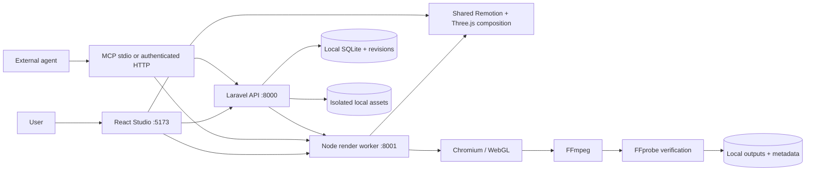

# Local runtime

All listeners bind to127.0.0.1. The frontend reverse proxy keeps browser API/media requests same-origin. Core operations work without a model provider. MCP does not expose arbitrary JavaScript, shell, URL fetch or filesystem tools.

The strict Zod schema defines one canonical model. Laravel validates through the worker before persisting canonical project JSON; revisions are transactional. Render requests capture an immutable source project plus its hash/settings, then return a real background job ID. The worker journals queue state and recovers interrupted jobs as retryable failures after restart. Render metadata contains the actual encoded properties fromFFprobe. Exports never report completion until output verification finishes.

The preview and exports use the same composition. Render timing is frame-derived, including actual3D camera motion. Fonts are local, awaited before render and fail explicitly if required typography cannot load. Project assets are registered and isolated; renderer metadata cannot introduce remote media.

Local-first boundaries and tradeoffs are detailed in the ADRs. The worker currently owns its serial queue instead of Laravel's database queue. There is no multi-user tenancy, remote hosting certification, arbitrary scene-code injection, OAuth discovery or claim of verified GPU encoding.
